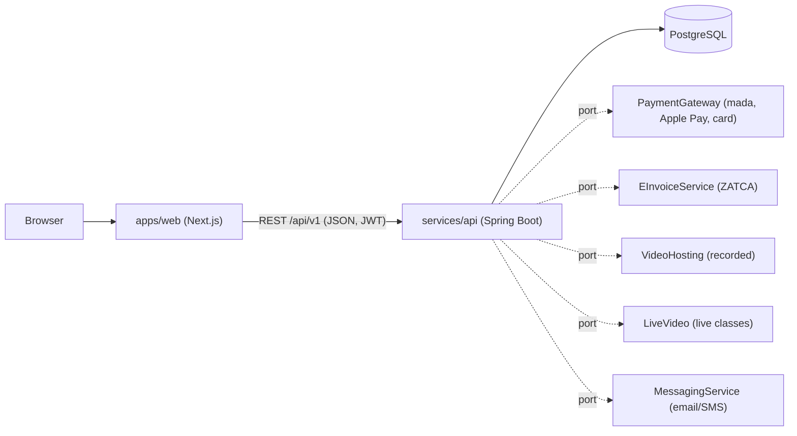

# Architecture



## Folder map

```
apps/web/src
  app/[locale]/...      pages (ar | en). Server components read the catalogue; client components handle login, cart, checkout, my courses
  components/           UI pieces (Header, CourseCard, BuyBox, AuthForm, GpmfSpiral...)
  lib/api.ts            the ONLY place that talks to a backend (mock | http)
  lib/store.tsx         auth + cart state
  lib/dict/             ar.ts, en.ts (all UI text)
  lib/mock-data.ts      sample catalogue (also the DB seed source)
services/api/src/main/java/sa/gba/academy
  auth/ catalog/ orders/ learning/   feature packages (controller + SQL)
  integrations/                      ports + fake adapters
  config/ common/                    CORS, auth interceptor, errors
services/api/src/main/resources/db/migration   Flyway SQL
```

## Key design choices

- **Two modes for the web**: `mock` (no backend, localStorage) and `http`. Lets designers and content people work without Java.
- **Catalogue JSON is built by PostgreSQL** (`json_build_object`) and passed through, so the contract matches `types.ts` exactly with little Java mapping code.
- **Ports and adapters** for every external system. Controllers depend on interfaces; `academy.integrations.*` in `application.yml` chooses `fake` or `real`.
- **Offerings**: one course can be sold as recorded, live or blended. Price, dates, access period and seats belong to the offering.
- **Money**: integer halalas, VAT included in shown prices.
- **Auth**: BCrypt passwords, stateless JWT (`Authorization: Bearer`). No server sessions.
- **i18n**: URL prefix `/ar` or `/en`; `dir` is set on `<html>`.
