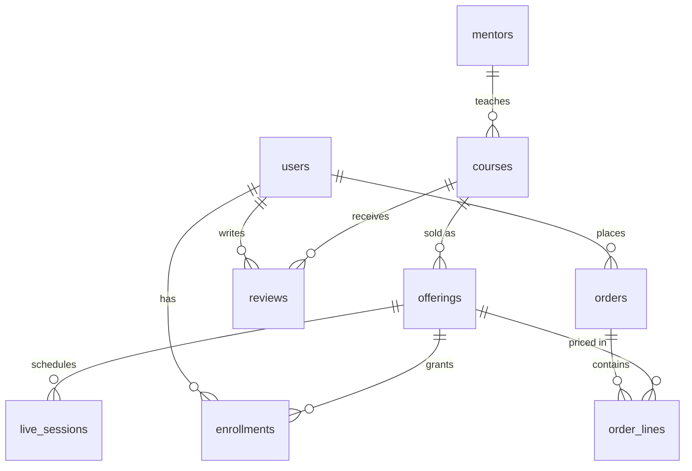

# Data model

Source of truth: `services/api/src/main/resources/db/migration/V1__schema.sql`.

| Table | Notes |
| --- | --- |
| `users` | `roles` array (learner, mentor, admin). `registering_for` = `self` or `child` (guardian creates the account). |
| `mentors`, `courses` | Text fields are JSONB `{ar,en}`. `courses.modules` holds the syllabus as JSON (modules, lessons with ids, kind, minutes). Rating, review_count, learners are denormalised counters. |
| `offerings` | `mode` recorded / live / blended, `price_halalas` (VAT incl.), `access_days` for recorded access. |
| `live_sessions` | `seats`, `seats_taken`; `join_url` filled by the live-video adapter. |
| `orders`, `order_lines` | Order number `GBA-YYYY-NNNNN`, VAT split, `gateway_ref`, `invoice_number`. |
| `enrollments` | One per user and offering; `completed_lesson_ids`, `progress_pct`, `certificate_code`. |
| `reviews` | Only enrolled users may post (checked in `LearningController`). Mentor reply is a JSONB. |

Rules: never store card data. Add columns with a new Flyway migration. If the syllabus needs per-lesson analytics, promote `modules` to its own tables in a new migration.
