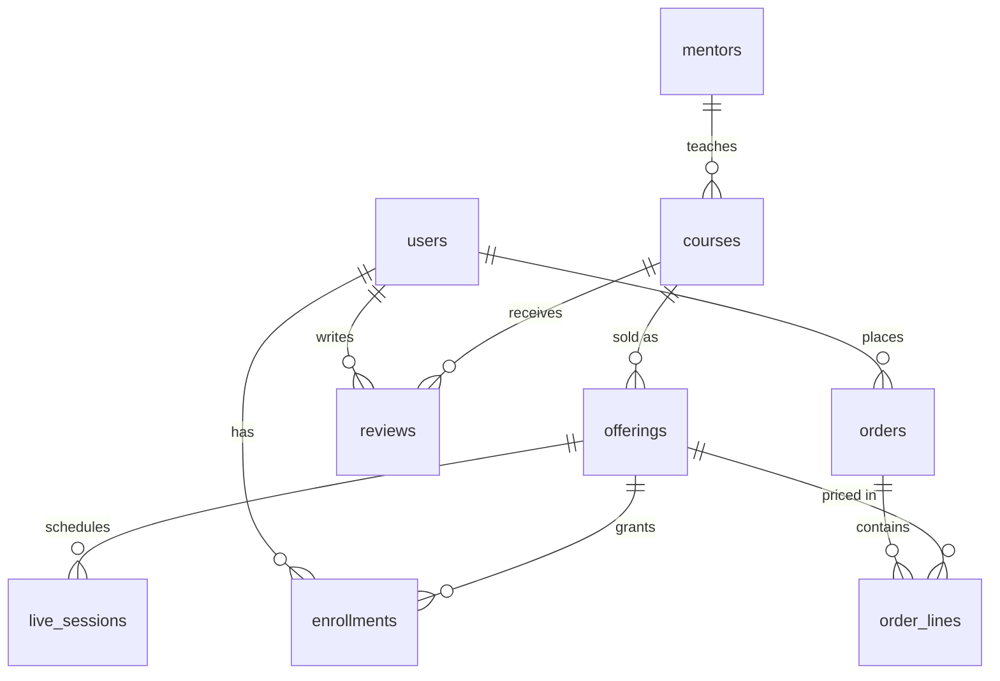

# Data model

Source of truth: `services/api/src/main/resources/db/migration/V1__schema.sql`.

| Table | Notes |
| --- | --- |
| `users` | `roles` array (learner, mentor, admin). `registering_for` = `self` or `child` (guardian creates the account). |
| `mentors`, `courses` | Text fields are JSONB `{ar,en}`. `courses.modules` holds the syllabus as JSON (modules, lessons with ids, kind, minutes). Rating, review_count, learners are denormalised counters. |
| `offerings` | `mode` recorded / live / blended, `price_halalas` (VAT incl.), `access_days` for recorded access. |
| `live_sessions` | `seats`, `seats_taken`; `join_url` filled by the live-video adapter. |
| `orders`, `order_lines` | Order number `GBA-YYYY-NNNNN`, VAT split, `gateway_ref`, `invoice_number`. |
| `enrollments` | One per user and offering; `completed_lesson_ids`, `progress_pct`, `certificate_code`. |
| `reviews` | Only enrolled users may post (checked in `LearningController`). Mentor reply is a JSONB. |

Rules: never store card data. Add columns with a new Flyway migration. If the syllabus needs per-lesson analytics, promote `modules` to its own tables in a new migration.

## Authoring, capacity, promo codes, uploads (V6)
- `courses`: `status` (`draft|pending|approved|rejected`), `review_note`, `submitted_at`, `created_by`, `materials` and `quizzes` (JSONB; quizzes keyed by lesson id, answers stay on the server). Constraint: `published` implies `status = 'approved'`.
- `offerings`: `capacity` and `min_learners` (live and blended; `min_learners <= capacity`). Order creation locks the offering row and refuses when enrolments reach `capacity`.
- `live_sessions`: `join_url`, `meeting_provider` (`google_meet|manual|fake`), `meeting_ref` (provider event id, used to move or cancel).
- `mentors.image_url`; `media_files` (uploaded file metadata: kind, storage key, uploader).
- `promo_codes` (`code` upper case, `percent_off` 1-100, `max_uses`, `used_count <= max_uses`, `expires_at`, `active`), `promo_redemptions` (one row per promo and user), `orders.promo_code`, `orders.discount_halalas`.

## Integrity and indexes (V5)
- `users`: unique on `lower(email)`.
- `orders`: `total = subtotal + vat`, all amounts >= 0. `order_lines.price_halalas >= 0`.
- `enrollments`: `progress_pct` 0-100; one enrollment per user and offering.
- `live_sessions`: `0 <= seats_taken <= seats`, `duration_min > 0`.
- `courses`/`mentors`: rating 0-5.
- Indexes cover every foreign key, `orders(user_id, created_at desc)`, `live_sessions(offering_id, starts_at)`, published courses by popularity, and trigram search on course title/subtitle.
- Verify with `scripts/db-check.sh` (needs a PostgreSQL server; CI does this on every push).
