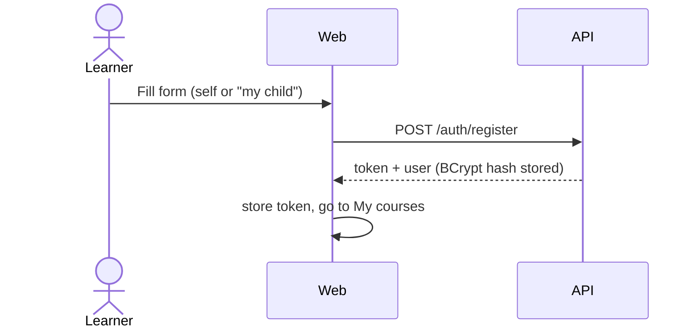
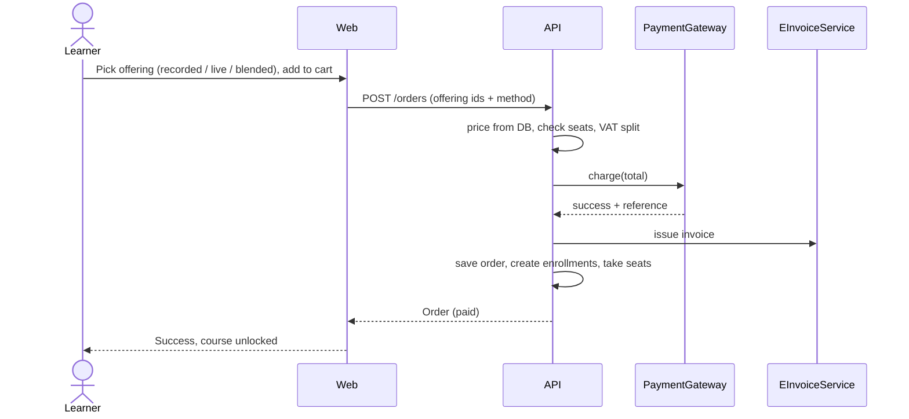

# User flows

## Register and log in

Child accounts: the adult registers; a child profile under the guardian is planned (see status).

## Choose, pay, unlock

## Learn
My courses shows progress and the next live session. The learn page loads `GET /me/enrollments/{slug}/content` (videos, files, which lessons have a quiz; the public course JSON does not carry them). A video lesson plays the uploaded file or the YouTube/Vimeo link. A lesson with a quiz is completed by passing it (`POST .../quiz`, graded on the server); other lessons use "mark as done". Files are listed per lesson and per course. At 100% a certificate code is generated.

## Review a mentor's course
Only enrolled learners can post a rating and comment; the course rating is recomputed. Mentor replies are stored in `reviews.mentor_reply` (mentor back-office is planned).

## Live session
Offering of mode `live` or `blended` has a `capacity` and `min_learners` and `live_sessions`. The offering row is locked at purchase; `sold_out` when enrolments reach capacity. Each session has a meeting link (typed by staff, or created by the `LiveVideo` adapter, Google Meet when enabled). The mentor joins from My live sessions; an enrolled learner clicks Join in the lesson (`GET /me/sessions/{id}/join`). Details and Google setup: `integrations/video.md`.

## Author a course (mentor) and approve (admin)

```mermaid
stateDiagram-v2
  [*] --> draft: mentor POST /mentor/courses
  draft --> pending: submit (needs title, a lesson, an offering)
  pending --> draft: mentor withdraws
  pending --> approved: admin approves (optionally publishes)
  pending --> rejected: admin sends back with a note
  rejected --> pending: mentor edits and resubmits
  approved --> approved: mentor edits content only; admin edits everything
```

Courses a mentor creates are never visible to learners until approved (`published` implies `approved`, enforced by a database constraint). Admin-created courses are approved at once.

## Buy with a promo code
The cart total is validated with `POST /promo/validate` (percentage of the VAT-inclusive total, one use per learner, expiry and usage limit). `POST /orders` re-checks and redeems the code in the same transaction; a 100% code makes the order free (no gateway, no invoice).

## Announcements
Admin creates banners (bilingual text, redirect link, colour, dates). The home page calls `GET /banners` and rotates the live ones.
