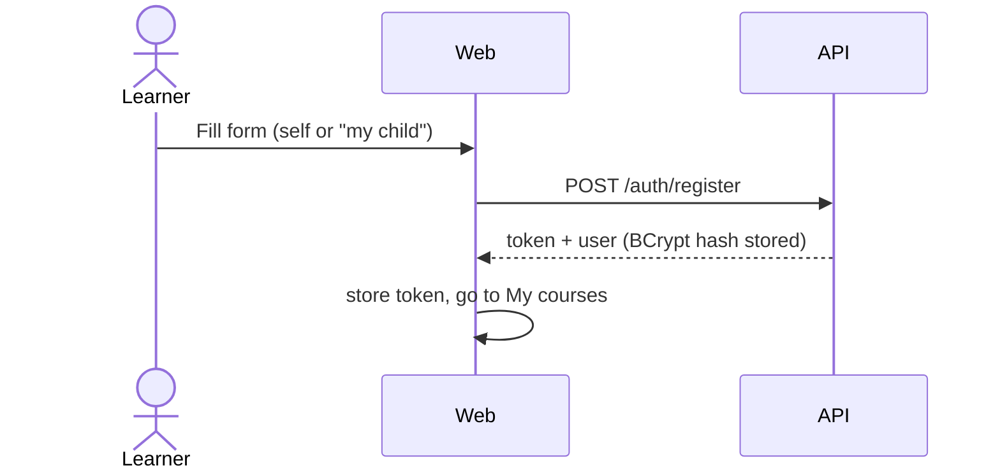
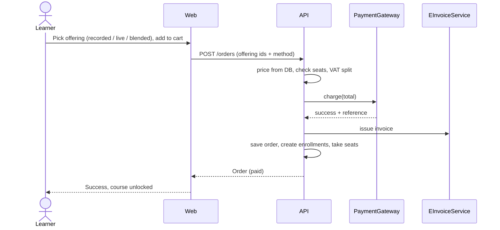

# User flows

## Register and log in

Child accounts: the adult registers; a child profile under the guardian is planned (see status).

## Choose, pay, unlock

## Learn
My courses shows progress and the next live session. The learn page lists lessons; "mark as done" calls the complete endpoint. At 100% a certificate code is generated. Video and live room are placeholders until adapters exist.

## Review a mentor's course
Only enrolled learners can post a rating and comment; the course rating is recomputed. Mentor replies are stored in `reviews.mentor_reply` (mentor back-office is planned).

## Live session
Offering of mode `live` or `blended` has `live_sessions`. Seats decrease on purchase; `sold_out` when full. Joining: `LiveVideo.joinLink` (to be implemented).
